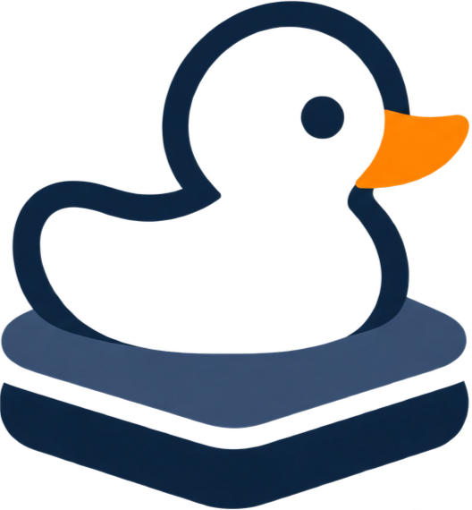
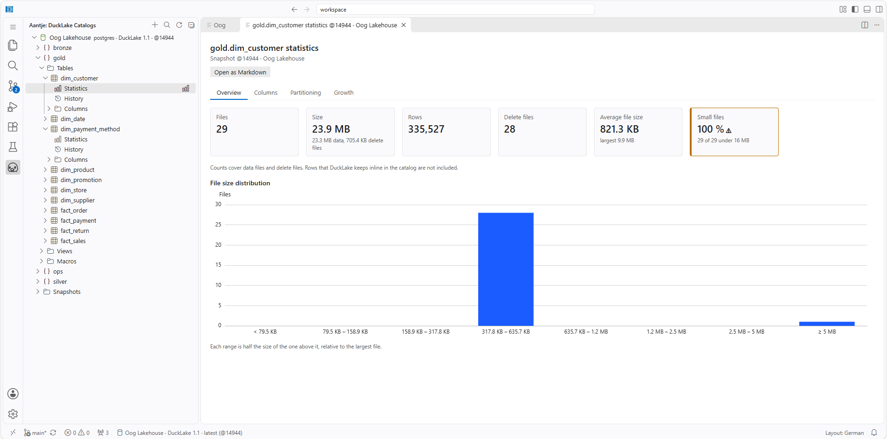
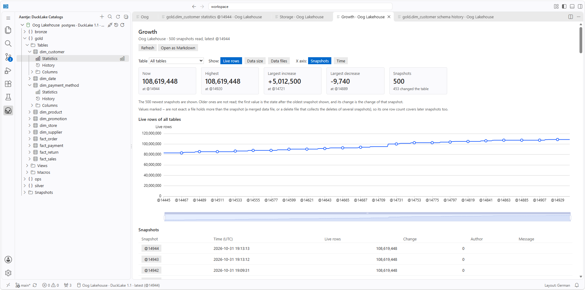
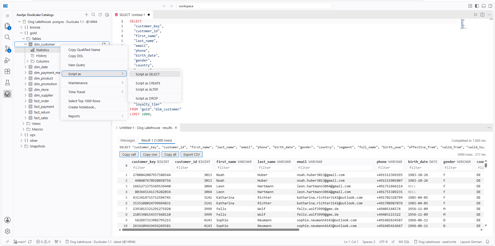
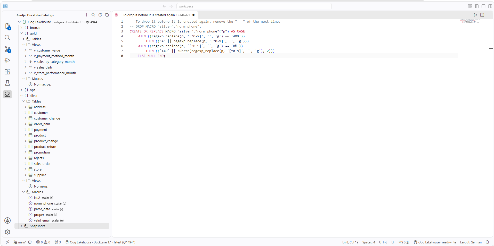

<p align="center">
  
</p>

# aantje

Explorer, time travel and SQL editor for [DuckLake](https://ducklake.select) catalogs, inside VS Code.

Project site: [aantje.dev](https://aantje.dev). Source and issues: [github.com/TEitelberg/aantje](https://github.com/TEitelberg/aantje).

aantje adds an explorer to the Activity Bar and a SQL editor. It runs in desktop VS Code and in code-server.

- Browse schemas, tables, views, macros and columns.
- Go back in time to any snapshot, compare schemas and see which rows changed.
- Generate `SELECT`, `CREATE`, `ALTER` and `DROP` scripts for every object.
- Run SQL with completion, hover help and result grids.
- Create a DuckLake in Azure (PostgreSQL and ADLS Gen2) from the editor, signed in with your Microsoft account.
- Reports show the health, storage, growth, activity and dependencies of your lake and suggest maintenance steps.

The catalog can live in DuckDB, SQLite or PostgreSQL, or be served by a DuckDB server over Quack. The explorer only reads; the SQL editor runs whatever SQL you write, with a read-only switch per connection (on a Quack server the rights of the token decide).

The complete list of features and their limits is in [Features](docs/en/features.md).

## Screenshots

**Table statistics.** File count, size and the distribution of file sizes of a table; a warning shows when most files are small.



**Growth.** How the rows, the size or the number of files of a table, or of the whole lake, changed over the snapshots.



**Script as SELECT.** Every node of the tree can be scripted. The script opens in the SQL editor, and the result appears in a grid below it.



**Macros.** Macros of a lake appear in the tree. Script as CREATE gives the statement with the matching DROP as a comment.



## Requirements

- VS Code 1.140 or newer. aantje runs in desktop VS Code and in code-server.
- Windows x64 or Linux x64. aantje ships a native DuckDB binding, so there is one package per platform; macOS and arm64 are not supported.
- A DuckLake catalog that follows specification 1.x. aantje checks the version when it connects.
- Reading data and the SQL editor need the DuckDB extensions `ducklake`, `postgres`, `sqlite` or `quack`, `httpfs` (for S3 and Quack) and `azure` (for an Azure lake). The explorer of a Quack catalog needs `quack` too. DuckDB downloads them on first use, so that needs internet access once. On a machine without internet, put them into a directory and set `aantje.duckdb.extensionDirectory`.
- **Create Notebook...** needs the Jupyter extension (`ms-toolsai.jupyter`) and a Python 3 kernel with `pip`.
- aantje runs where the workspace runs. In code-server or in a remote window, file paths and host names are resolved on the server, not on your computer.

## Installation

Search for `aantje` in the Extensions view, or install it from the command line:

```sh
code --install-extension teitelberg.aantje
```

Or install the VSIX package of your platform from the [releases page](https://github.com/TEitelberg/aantje/releases) (or [build it yourself](docs/en/packaging.md)) with **Extensions: Install from VSIX...** or `code --install-extension aantje-win32-x64-0.1.0.vsix`.

[Installation](docs/en/installation.md) describes the platforms and how to preconfigure connections for a whole machine.

To try aantje against a complete DuckLake first, the [Docker stack](docker/README.md) starts a workbench with aantje, PostgreSQL, S3 storage, Gitea and sample notebooks with one command.

## Quick start

1. Open the **aantje** view in the Activity Bar.
2. Choose **Add Connection...** (the `+` in the view title, or **aantje: Add Connection...** in the Command Palette). Pick PostgreSQL, SQLite, DuckDB or DuckDB + Quack and answer the prompts: a name and then, for PostgreSQL, host, port, database, user, whether to use TLS, password, and whether SQL editor sessions are read-only; for SQLite and DuckDB, the path of the database file that holds the `ducklake_*` tables and whether SQL editor sessions are read-only; for DuckDB + Quack, host, port, whether to use TLS (aantje shows the fingerprint of the server certificate and pins it once you confirm it) and the token. Leave the password empty if the server needs none. aantje tests the connection before it saves it.
3. Expand the connection. aantje connects on the first expansion and lists the schemas. Expand a schema for the folders Tables and Views, a table or a view for its folder Columns.
4. Hover over a node for its tooltip. Right-click a node to **Copy Qualified Name**, to **Copy DDL** of a table or view, or to use the submenus Script as, Maintenance and Reports.
5. To see the catalog as it was earlier, click **Show Catalog at Snapshot...** (the history icon) on the connection and pick a snapshot. **Latest** goes back to following the newest snapshot. The status bar shows the active one.
6. Use **Search Catalog...** (the magnifier in the view title) to find a table or view by name. **Refresh** (in the view title, or the button on a connected connection, a schema, its folders Tables, Views and Macros, a table or a view) reopens the connection and reloads the tree, so that new commits and the newest snapshot show up.
7. Right-click a table and choose **Select Top 1000 Rows**. The first rows open in a grid for the snapshot that the tree shows. Click a header to sort, type into the boxes below the names to filter, and use the buttons to copy a cell, a row or all rows, or to export CSV.
8. Right-click a table and choose **Create Notebook...** to get a Jupyter notebook for it. Run the cells from the top; edit `QUERY` in the last cell to ask your own question.
9. If the data files are on S3, set `aantje.s3.endpoint` (and, if needed, `aantje.s3.region` and `aantje.s3.urlStyle`) and run **aantje: Set S3 Credentials...** once. **aantje: Clear S3 Credentials** removes them again. Without stored credentials aantje uses `AWS_ACCESS_KEY_ID` and `AWS_SECRET_ACCESS_KEY` from the environment.
10. Right-click a table and choose **New Query**. A SQL editor opens with the SELECT of the table, and it belongs to the connection. Press `F5` to run it, or put the cursor into a statement and press `Ctrl+Enter` to run only that one. `Shift+F5` cancels a run. The results open below the query and stay with it; **Hide Results** in the editor title (`Ctrl+Alt+R`) hides them and **Show Results** brings the last run back. The status bar shows the connection and the mode of the session of the editor (`read/write` or `read-only`); click it to select another connection, to switch the mode or to close the session.

If a connection fails, open the output channel **aantje** (View > Output); passwords and tokens are masked there.

## Settings

| Setting                            | Default       | Description                                                                                                                                                                                                                                                                                                                                                                            |
| ---------------------------------- | ------------- | -------------------------------------------------------------------------------------------------------------------------------------------------------------------------------------------------------------------------------------------------------------------------------------------------------------------------------------------------------------------------------------- |
| `aantje.connections`               | `[]`          | The connection profiles. Machine scope; passwords and tokens are never stored here.                                                                                                                                                                                                                                                                                                    |
| `aantje.queryTimeoutSeconds`       | `30`          | Maximum duration of a single catalog query, in seconds (at least 1). Applies to PostgreSQL, DuckDB and Quack catalogs; a SQLite catalog is read from memory and has no limit. It also limits one reading of data (rows or the columns of a view) from the attach of the catalog on; installing the DuckDB extensions (the first download, about 40 MB) has its own limit of 5 minutes. |
| `aantje.s3.endpoint`               | `""`          | S3 endpoint that holds the Parquet data, as `host:port` or `http(s)://host:port`. Empty means AWS. Used by Select Top 1000 Rows and written into notebooks. Machine scope. The key and secret are not a setting: use Set S3 Credentials.                                                                                                                                               |
| `aantje.s3.region`                 | `"us-east-1"` | S3 region for reading data. Machine scope.                                                                                                                                                                                                                                                                                                                                             |
| `aantje.s3.urlStyle`               | `"path"`      | How bucket names are put into S3 URLs: `path` or `vhost`. Most S3-compatible servers need `path`. Machine scope.                                                                                                                                                                                                                                                                       |
| `aantje.duckdb.extensionDirectory` | `""`          | Directory with the DuckDB extensions `ducklake`, `postgres`, `sqlite` or `quack`, and `httpfs`. Empty uses the DuckDB default, which downloads them on first use and needs internet access. Set it for offline use. Machine scope.                                                                                                                                                     |
| `aantje.sql.maxRows`               | `10000`       | The most rows that the SQL editor keeps of one result (at least 1), at most 1000000. A longer result is cut and marked as partial; the rest is not read. Machine scope.                                                                                                                                                                                                                |

### Connection profiles

The Add Connection wizard writes `aantje.connections` for you. Edit the setting by hand only for the options that the wizard does not ask for (`metadataSchema`) or to provision a machine. Each entry has these properties:

| Property                                   | Used by                    | Description                                                                                                                                                                                                                                                                                                           |
| ------------------------------------------ | -------------------------- | --------------------------------------------------------------------------------------------------------------------------------------------------------------------------------------------------------------------------------------------------------------------------------------------------------------------- |
| `name`                                     | all                        | Display name in the explorer. Required.                                                                                                                                                                                                                                                                               |
| `kind`                                     | all                        | `postgres`, `sqlite`, `duckdb` or `quack` (a DuckDB server that serves the catalog over Quack). Required.                                                                                                                                                                                                             |
| `id`                                       | all                        | Stable identifier, also the key of the stored password or token. Defaults to a slug of the name.                                                                                                                                                                                                                      |
| `host`, `port`                             | PostgreSQL, Quack          | Where the catalog server is. `port` defaults to 5432, for Quack to 9494. A Quack server cannot be reached under the host name `quack`.                                                                                                                                                                                |
| `database`, `user`                         | PostgreSQL                 | The database that holds the catalog and the user to log in with.                                                                                                                                                                                                                                                      |
| `metadataSchema`                           | PostgreSQL                 | Schema that holds the `ducklake_*` tables. Defaults to the default schema of the connection.                                                                                                                                                                                                                          |
| `ssl`                                      | PostgreSQL, Quack          | Use TLS. Defaults to `true`, and to `false` for `localhost`, `127.0.0.1` and `::1`.                                                                                                                                                                                                                                   |
| `fingerprint`                              | Quack                      | SHA-256 fingerprint of the server certificate, pinned instead of the system trust store (for a self-signed certificate). The wizard reads it from the server and asks before it pins it. Needs `ssl`.                                                                                                                 |
| `path`                                     | SQLite, DuckDB             | Database file that holds the `ducklake_*` tables.                                                                                                                                                                                                                                                                     |
| `azureAccount`, `azureTenant`, `azureAuth` | PostgreSQL                 | Azure storage account that holds the data files of the lake, the tenant to sign in to, and `entra` to sign in to PostgreSQL with your Microsoft account instead of a password. The wizard asks for them when you choose Microsoft Entra ID; **Create Azure DuckLake...** and **Import Azure DuckLake...** write them. |
| `readOnly`                                 | PostgreSQL, SQLite, DuckDB | Open the SQL editor sessions of this connection read-only. Defaults to `false`: writable. The wizard asks and suggests `true` for a DuckDB file, because a writable session locks the file against the explorer. Not for Quack: a Quack server has no such lock, and the server decides what its token may do.        |

```json
{
  "aantje.connections": [
    {
      "name": "Lake",
      "kind": "postgres",
      "host": "localhost",
      "port": 5432,
      "database": "ducklake",
      "user": "ducklake",
      "ssl": true
    },
    {
      "name": "Local catalog",
      "kind": "sqlite",
      "path": "/data/catalog.sqlite"
    }
  ]
}
```

## Security

The model, the limits and the known bypasses are in [Security](docs/en/security.md). In short:

- The explorer is read-only. PostgreSQL sessions are read-only, a SQLite catalog is read from an in-memory copy of the file, a DuckDB file is opened read-only, and a Quack catalog is read by an in-memory DuckDB that can reach that one server and nothing else.
- The SQL editor runs any SQL with the rights of the credentials of the connection. aantje adds no confirmation; open an editor only on catalogs and scripts that you trust. A read-only session guards against a slip, not against a hostile script.
- Passwords, Quack tokens and S3 credentials are kept in the VS Code secret storage and never written to settings, logs, error messages or notebooks.
- The SQL of a view comes from the catalog, so aantje asks once per connection before it runs anything of a view. The SQL of a view runs with your rights and can read files and use the network; aantje refuses a view that calls the maintenance functions of DuckLake, which is no sandbox. A catalog can also name any path as a data file: open only catalogs you trust.
- All settings have machine scope, so a workspace cannot add connections or redirect the S3 endpoint.
- **No telemetry.** The network traffic is the PostgreSQL and Quack connections that you configured and, when you read data, the S3 endpoint that you configured and the one-time download of the DuckDB extensions from `extensions.duckdb.org` (not with `aantje.duckdb.extensionDirectory`). The Azure commands add Azure Resource Manager, Microsoft Entra, your storage account and one IP lookup (see [Azure DuckLake](docs/en/azure-lake.md)).

To report a vulnerability, see [SECURITY.md](SECURITY.md) and report it [privately](https://github.com/TEitelberg/aantje/security/advisories/new).

## Documentation

[Documentation index](docs/en/index.md): [Features](docs/en/features.md) and their limits, architecture, development and testing. [CONTRIBUTING.md](CONTRIBUTING.md) explains how to propose a change. [CHANGELOG.md](CHANGELOG.md) lists the changes of each release.

## Author

**Tillmann Eitelberg** (publisher `teitelberg`). Project site [aantje.dev](https://aantje.dev), source on [GitHub](https://github.com/TEitelberg/aantje).

## License

[MIT](LICENSE), © 2026 Tillmann Eitelberg. The licences of the bundled packages are in [THIRD-PARTY-NOTICES.md](THIRD-PARTY-NOTICES.md).
